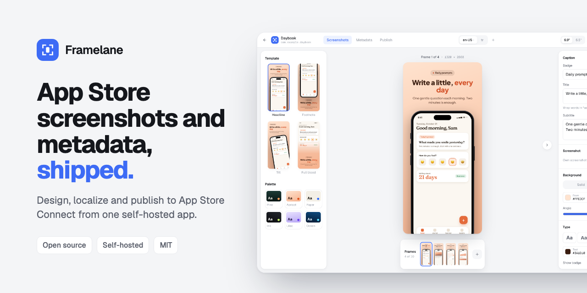
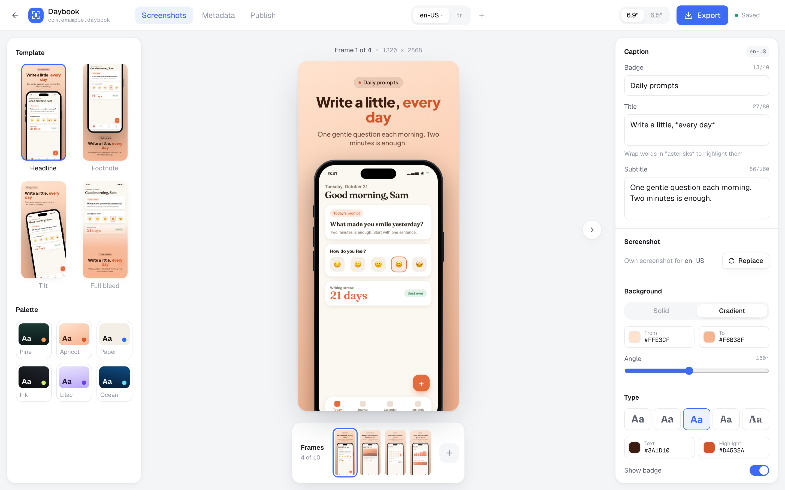
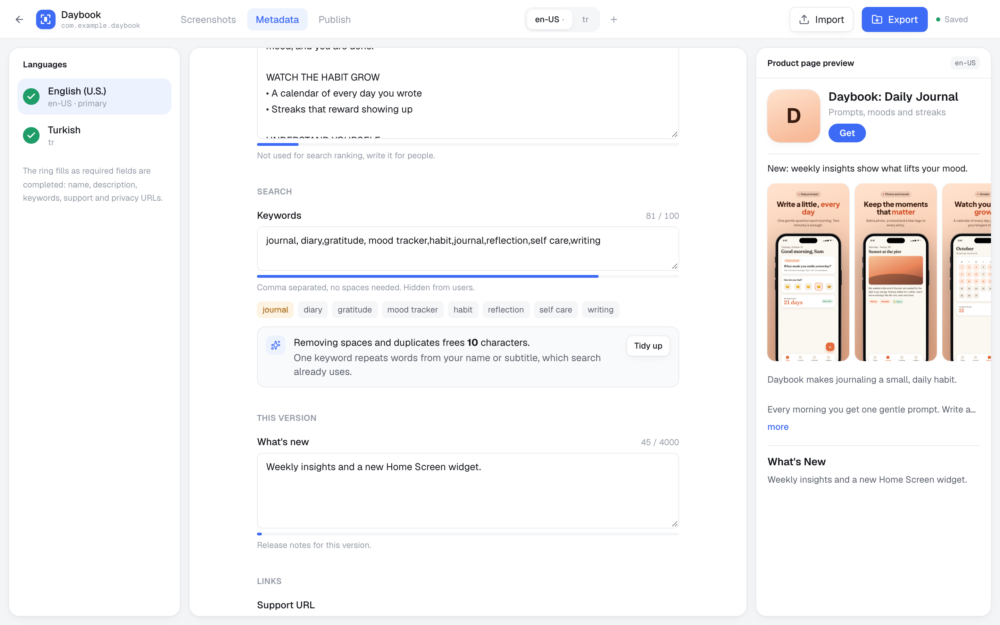
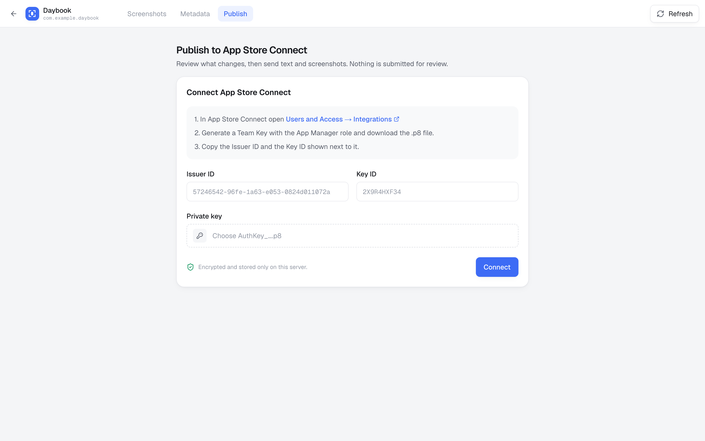

<p align="center">
  
</p>

<p align="center">
  <b>Design, localize and publish App Store screenshots and metadata from one self-hosted app.</b>
</p>

<p align="center">
  <a href="https://github.com/Metehan-Bicer/framelane/actions/workflows/ci.yml"></a>
  <a href="LICENSE"></a>
  <a href="https://github.com/Metehan-Bicer/framelane/pkgs/container/framelane"></a>
</p>

---

Shipping an app update means framing screenshots for every device size, translating captions and store text for
every language, and uploading all of it to App Store Connect. That usually takes a design tool, a spreadsheet and
fastlane. Framelane does the whole flow in one place, runs on your own machine, and talks to App Store Connect with
your own API key.

<p align="center">
  <b><a href="https://framelane.metehanbicer.com">Try the live demo</a></b> · resets every night, App Store Connect turned off
</p>

<p align="center">
  
</p>

## Features

**Screenshots**
- Drop in raw simulator captures, pick a template, and get store-ready frames: Headline, Footnote, Tilt and Full bleed.
- Device frames drawn in code (no Apple artwork), palettes, gradients and five caption fonts.
- Captions and screenshots per language. Wrap a word in `*asterisks*` to highlight it.
- Export every language at the exact sizes App Store Connect accepts, as a zip.



**Metadata**
- Name, subtitle, promotional text, description, keywords, release notes and URLs for every language, with the App
  Store character limits shown as you type.
- A keyword helper that removes spaces and duplicates and flags words your name and subtitle already cover.
- A product page preview built from your own frames.
- Import and export fastlane `metadata/` folders and EAS `store.config.json`, so it fits the tools you already use.



**Publishing**
- Connect an App Store Connect API key once. It is checked with Apple and stored encrypted on your server.
- See every change field by field before anything is sent. Empty fields never erase text that is already live.
- Push text and replace screenshot sets per language. Nothing is submitted for review; that stays your call.



## Quick start

```bash
docker run -d --name framelane -p 8300:3000 -v framelane-data:/data ghcr.io/metehan-bicer/framelane:latest
```

Open http://localhost:8300, add your app with the same bundle ID as in App Store Connect, and drop in screenshots.
Everything is stored in the `framelane-data` volume: an SQLite database, your uploads and the key that encrypts your
App Store Connect credentials.

To protect it with a password, for example on a server:

```bash
docker run -d --name framelane -p 8300:3000 -v framelane-data:/data \
  -e FRAMELANE_PASSWORD=change-me ghcr.io/metehan-bicer/framelane:latest
```

See [`.env.example`](.env.example) for every setting and [SECURITY.md](SECURITY.md) for how keys are stored.

## How it compares

|  | Framelane | fastlane `deliver` | Hosted screenshot builders |
| --- | --- | --- | --- |
| Design screenshots | Yes | No | Yes |
| Captions per language | Yes | No | Usually |
| Edit metadata with limits | Yes | Text files | Some |
| Upload to App Store Connect | Yes, with a diff first | Yes | Some |
| Runs on your machine | Yes | Yes | No |
| Price | Free, MIT | Free, MIT | Subscription |

fastlane is still the right tool for CI pipelines and builds; Framelane can export its `metadata/` folder and a
`deliver`-style screenshot zip, so the two work together.

## Roadmap

- [x] Screenshot editor, four templates, per-language captions and screenshots
- [x] Export at App Store sizes for iPhone 6.9" and 6.5"
- [x] Metadata editor with limits, keyword helper and product page preview
- [x] fastlane and EAS import and export
- [x] Publish text and screenshots to App Store Connect with a diff first
- [ ] iPad sets
- [ ] Optional AI translation with your own key or a local model
- [ ] Google Play
- [ ] CLI and MCP server, so scripts and agents can drive Framelane

Ideas and bug reports are welcome in [issues](https://github.com/Metehan-Bicer/framelane/issues).

## Development

Framelane is a Next.js 16 app with React 19, Tailwind CSS 4, SQLite and Drizzle. You need Node 22 or newer.

```bash
npm install
npm run seed:demo   # optional: adds Daybook, a fictional demo app in two languages
npm run dev
```

| Command | What it does |
| --- | --- |
| `npm run dev` | Start the dev server |
| `npm test` | Unit tests (Vitest) |
| `npm run test:e2e` | End-to-end tests (Playwright, needs `npm run build` first), against a fake App Store Connect in `e2e/fake-asc.mjs` |
| `npm run lint` / `npm run typecheck` | ESLint and TypeScript |
| `npm run db:generate` | Create a migration after changing `src/db/schema.ts` |
| `npm run demo:screens` | Re-render the Daybook demo screenshots from `demo/screens.html` |
| `npm run render:sheet -- <dir> <out.png>` | Render every template with Node, handy when changing `src/lib/design/render.ts` |

`docker compose up --build` builds and runs the image from source.

Screenshots are drawn with the Canvas 2D API only (`src/lib/design/render.ts`), so the browser preview, the export and
Node (through `@napi-rs/canvas`) produce the same pixels. App Store rules live in `src/lib/app-store/` and the App
Store Connect client in `src/lib/asc/`.

## Contributing

Issues and pull requests are welcome. See [CONTRIBUTING.md](CONTRIBUTING.md).

## License

[MIT](LICENSE). Not affiliated with Apple. App Store and App Store Connect are trademarks of Apple Inc.
